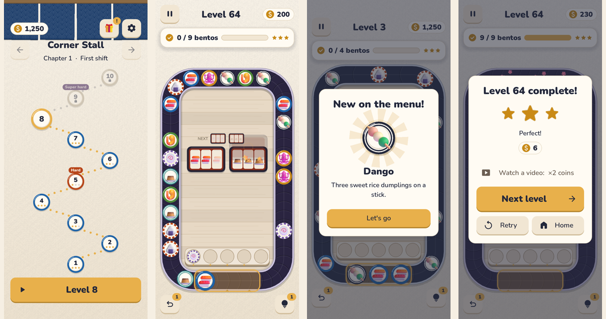

<p align="center"></p>

<h1 align="center">Sushi Loop</h1>

<p align="center"><b>Plates ride the belt one step every time you take one.<br>
Pack each bento with three of a kind before the counter fills up.</b></p>

<p align="center">
<a href="https://github.com/MehulKumars/sushi-loop/releases"><b>⬇ Download the newest test build (Android APK)</b></a><br>
Android 7 or newer · free · no timer · plays offline
</p>



## How to play

1. Plates ride a loop-shaped conveyor around a sushi counter. Only the plates in the gold
   **window** at the bottom can be taken.
2. Tap one. It flies into an open bento that wants that dish, or waits on the **counter** if none
   does.
3. Every take moves the belt one step, so a plate you leave comes back a lap later. The order
   you take them in is the puzzle.
4. Three of a kind close a bento. The next bento opens, and matching plates on the counter hop
   straight in.
5. If the counter is full and a plate has nowhere to go, the level is lost. Retry is always free.

Three stars for a clean win that keeps the counter within the level's limit (the small gold
stars under the counter), two for any clean win, one after a continue.

## What's in it

- **1000 levels in 100 chapters**, each a restaurant with its own colours and its own twist: a
  two-plate window, one bento at a time, the next bentos hidden, long loops, a full belt, a
  small counter, and later two twists at once. Every ten levels climb to hard and super-hard
  levels, with breathers in between. Every level is proven winnable and rated by bots before
  it ships.
- **Straight into play:** the first launch opens level 1, no menu. Home is a road of plates
  for the current chapter: tap a won plate to replay it, or the big button for the next level.
- **Seven dishes**, from salmon nigiri to purin, each introduced with its own card. Every dish
  has its own plate rim colour and pattern, so colour is never the only clue.
- **Calm and satisfying:** plates squash and arc into their bentos, lids drop with a gold bow
  and a puff of sakura petals, cascades climb a koto scale, and a win ends with petals falling
  over the counter. Calm piano music. Reduce Motion turns all the movement off.
- **Fair:** a free undo and hint every level, and a free step back the moment the game proves a
  level can no longer be won. No timers, no lives, no energy.
- **Rewards:** coins for stars (more on hard levels), a gift every 15 stars, a bonus for every
  chapter. Coins buy hints, undos and continues. No purchases.
- **Ads only when you choose:** a video for a free continue, double coins, or a hint when you
  are out of coins. Full-screen ads only after a win, from level 8, never in your first
  session. No banners.

## Install the test build

1. On your phone, open the newest build on the [releases page](https://github.com/MehulKumars/sushi-loop/releases)
   and download the `.apk` file (sign in to GitHub first: the repository is private).
2. Open it and allow your browser or file manager to install apps when Android asks.
3. Sushi Loop installs as its own app, next to Halves. Newer builds update it in place, and
   your progress stays.

Test builds are signed with a development key and use simulated ads (a short note shows where a
real video or full-screen ad would play). They are not the Play Store build.

## Status

Version 0.4.0: 1000 levels with a measured difficulty curve, a new home (a road of plates per
chapter) and start (first launch goes straight into level 1), one look instead of the template's
five, and the desktop template's leftovers removed. Before Google Play: real ads (AdMob account
and plugin), a privacy policy page, a phone feel test, the final name, store page and release
signing.

---

## For developers

Built in **Godot 4.7.2** (GDScript, Compatibility renderer, portrait 720 px canvas, Android
first). It started from the studio's [mobile game template](https://github.com/MehulKumars/godot-mobile-template)
(the `template` remote) and has since dropped its desktop leftovers and spare styles.

| Part | Where |
|---|---|
| Rules, API, progression, economy, ads and the level pipeline (the contract the code and tests follow) | [docs/SUSHI_LOOP.md](docs/SUSHI_LOOP.md) |
| Rules model, solver, bots, undo, doom detector, progression | `game/sushi/` |
| Reusable kit: `StateSolver`, `Rack`, `PathBelt` | `game/kit/` |
| Board, plates, bentos, art, palette and restaurants | `game/sushi/*_view.gd`, `sushi_art.gd`, `sushi_palette.gd` |
| Screens and popups | `ui/screens/`, `ui/popups/` |
| Baked levels; plan, generator and ratings | `data/levels/sushi_v2.json` (1000 levels, about 180 KB); `tools/levelgen/` (plan, generator, parallel bake, curve report in `reports/`) |
| Art, sounds, music, app icon | `assets/`, `tools/make_icon.gd`, `tools/audio/` |
| Tests | `tests/` |
| Rules for Claude Code | [CLAUDE.md](CLAUDE.md) |

```powershell
godot --path .                                                  # play on PC
powershell -ExecutionPolicy Bypass -File tools/check.ps1        # the done check (import, boot, all tests)
godot --headless --path . -s tools/levelgen/generate_sushi.gd   # bake the levels (about 15-25 min, all cores)
powershell -ExecutionPolicy Bypass -File tools/snapshots.ps1    # screenshots of every screen
godot --path . -s tools/sushi_playtest.gd -- 9 solve           # play a level for real, frames in build/playtest/
```

The phone test APK is the "Android Debug APK" preset exported with the release template and the
debug key (see CLAUDE.md, "Phone test APK").

**Licences.** Our code is in `core/`, `game/`, `ui/`, `tests/` and `tools/`. Dish and decoration
art is Microsoft Fluent Emoji (MIT); plate, wood, chip and coin sounds are Kenney (CC0), the
musical cues are synthesised by us, the music is "First Light Particles" by Yoiyami (CC0). Fonts
are SIL OFL 1.1, icons Apache 2.0. Every third-party file is listed in
[ASSETS_LICENSES.md](ASSETS_LICENSES.md).
